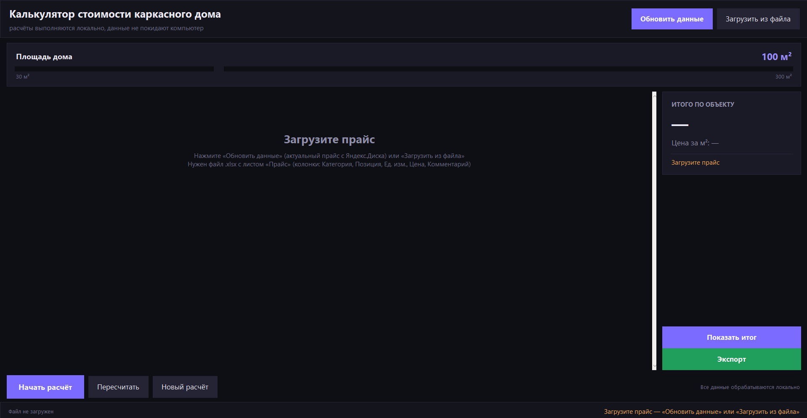
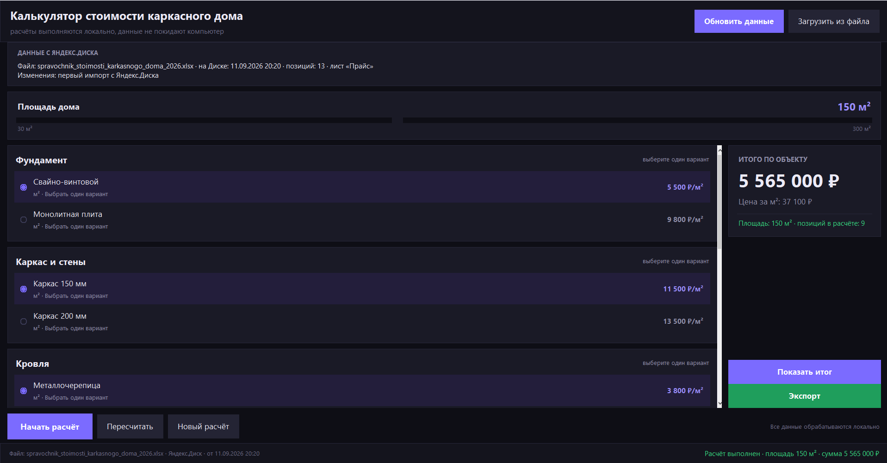
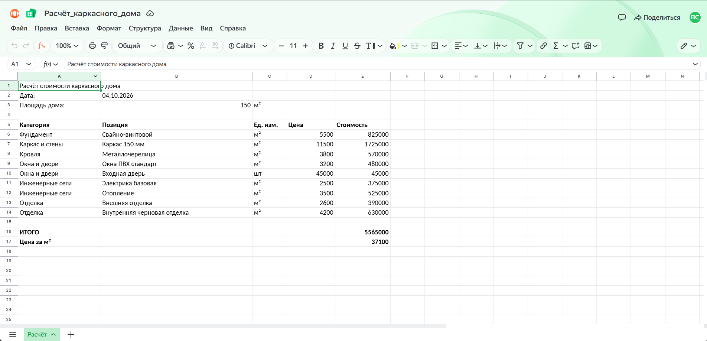
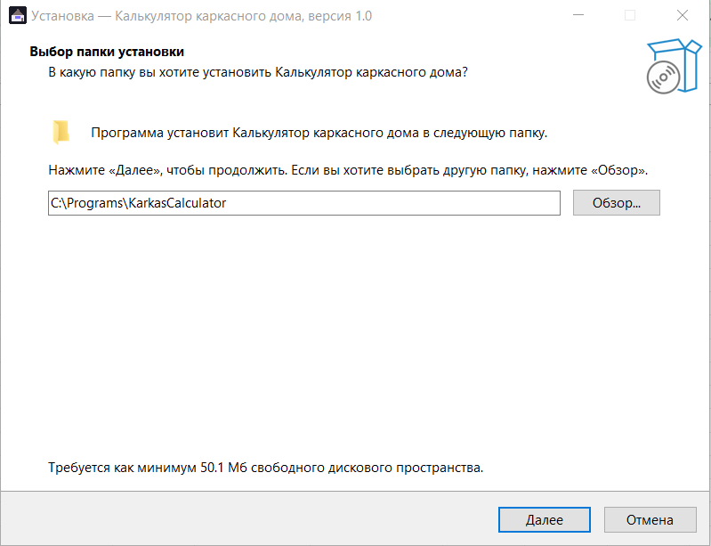

# Калькулятор стоимости каркасного дома (Estimate Calculator)

Десктоп-калькулятор стоимости каркасного дома с автообновлением прайса из Яндекс.Диска и экспортом готовой сметы в файл `.xlsx`.

---

## Проблема
Раньше менеджеры строительной компании рассчитывали сметы вручную в таблицах. Это приводило к ряду проблем:
- Цены на материалы и работы быстро устаревали, что вело к убыткам или спорам с клиентами.
- Ручной расчет отнимал много времени и был подвержен человеческим ошибкам.
- Не было единого актуального источника актуальных цен для всей команды.

---

## Решение
Разработан специализированный десктопный инструмент, который решает эти задачи:
- **Автозагрузка актуального прайса** прямо с Яндекс.Диска по нажатию кнопки «Обновить данные».
- **Гибкий расчет** по параметрам объекта (площадь дома, выбор материалов фундамента, каркаса, кровли и отделки).
- **Экспорт готовой сметы** в профессионально оформленный файл `.xlsx` для клиента или руководства.
- **Установка в один клик** под Windows с помощью готового установщика.

---

## Функции и стек технологий
- **Язык:** Python 3.10+
- **Интерфейс:** Tkinter (современный кастомный UI в тёмной теме с плавной анимацией)
- **Работа с Excel:** `openpyxl` (чтение прайса, экспорт сметы)
- **Облачное API:** Яндекс.Диск REST API (автоматическое получение и скачивание актуального прайс-листа)
- **Упаковка и дистрибуция:** PyInstaller (сборка в самостоятельный `.exe`), Inno Setup (создание установщика Windows)

---

## Как запустить

### Для пользователей (Windows)
1. Запустите готовый установщик из релизов или файл `запуска.bat` в папке проекта.
2. При первом запуске укажите или настройте подключение к Яндекс.Диску в файле `config.ini` (создается на основе `config.example.ini`).

### Из исходников
1. Установите Python 3.10+.
2. Установите зависимости:
   ```bash
   pip install openpyxl
   ```
3. Скопируйте файл `config.example.ini` в `config.ini` и при необходимости укажите ссылку/токен Яндекс.Диска.
4. Запустите приложение:
   ```bash
   python karkas_calculator.py
   ```

---

## Скриншоты

| Интерфейс приложения | Процесс расчёта |
| :---: | :---: |
|  |  |
| *Главное окно приложения и выбор параметров* | *Динамический расчет стоимости по категориям* |

| Экспорт сметы | Установщик Windows |
| :---: | :---: |
|  |  |
| *Экспорт готовой сметы в .xlsx* | *Инсталлятор программы для Windows* |
